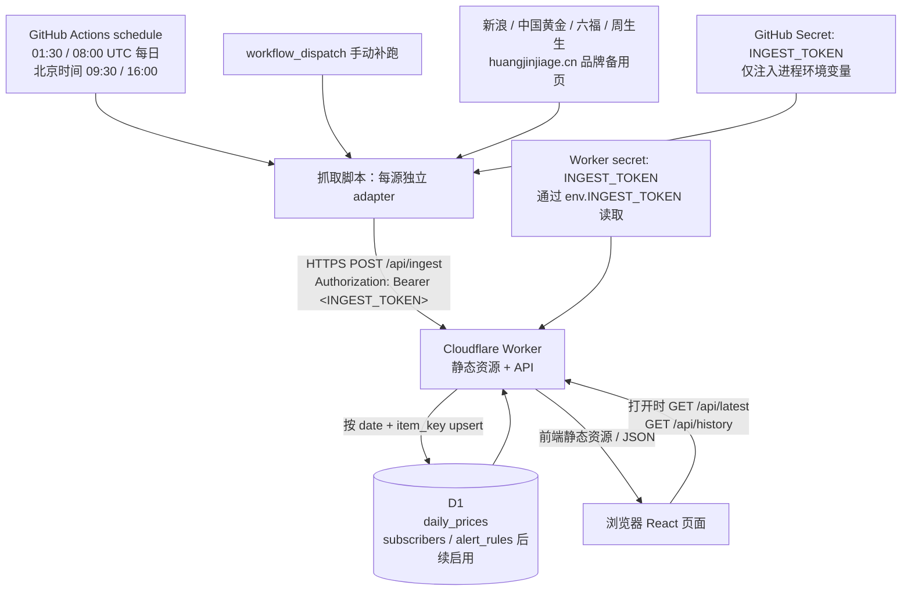

# gold-price 架构设计

## 文档状态与边界

本文记录已确定的目标架构。阶段①交付前端壳与配置；阶段②已实现本机 adapters、抓取脚本、上报客户端及离线单测；阶段③已实现三表 SQL 迁移、本地 D1、Worker 查询与鉴权 ingest API，并通过 Vitest + Miniflare 测试。前端行情属于阶段④，定时工作流属于阶段⑤；订阅者/提醒规则仅建表，不实现订阅 API、邮箱验证或发信。

## 数据流

抓取任务只负责拉取、校验、归一化、上报；Worker 校验鉴权和请求后写入 D1。数据不 commit 回仓库，不依赖静态 JSON 文件更新网站。Worker 托管 Vite `dist/`，浏览器与 API 同源。

### 目录与运行边界

- `src/`：React 前端。阶段①不发起业务 API 请求、不包含伪造金价。
- `ingest/adapters/`：阶段②实现每个来源的独立 adapter；共同输出下述标准记录。
- `worker/`：已实现 `/healthz`、静态资源和 latest/history/ingest API；未知 API 返回统一 JSON 404。
- `migrations/0001_initial.sql`：阶段③三表迁移及索引/约束。
- `.github/workflows/`：阶段⑤再建立定时抓取/保活，阶段①无 workflow 文件。

`wrangler.toml` 中正式环境保留 `DB` 绑定和 `YOUR_D1_DATABASE_ID`。`local` 命名环境同时绑定 `ASSETS` 和 `DB`，用全零占位 ID 运行本地 D1；`pnpm db:migrate:local` 和 `pnpm worker:dev` 共享 `.wrangler/` 下的数据库。静态资源路由配置参考 [Cloudflare Assets 配置说明](https://developers.cloudflare.com/workers/static-assets/binding/)；`/api`、`/api/*`、`/healthz` 先交给 Worker，避免未实现的 API 被 SPA HTML 掩盖。

## 数据模型（阶段③已建表）

### daily_prices

| 字段         | 类型 / 约束          | 含义                                                            |
| ------------ | ------------------------ | --------------------------------------------------------------- |
| `date`       | TEXT，必填，`YYYY-MM-DD` | 报价数据日期，按 Asia/Shanghai 口径                             |
| `item_key`   | TEXT，必填，白名单       | 稳定数据项标识，见下方数据源清单                                |
| `price`      | REAL，必填，有限且大于 0 | 元/克，入库前统一到两位小数；不接受 NaN、Infinity、空值或零占位 |
| `unit`       | TEXT，固定 `CNY/g`       | 所有入库价格统一人民币元/克                                     |
| `source_url` | TEXT，HTTPS，必填        | 该条记录的来源展示页 URL，服务端限制到对应来源白名单              |
| `fetched_at` | TEXT，UTC ISO 8601，必填 | 实际抓取时刻，区别于报价日期                                    |

唯一键为 **(`date`, `item_key`)**；另建 (`item_key`, `date`) 查询索引。当天早晚两次上报更新同一条记录，不增加日内点。重复上报 upsert 覆盖价格、单位、来源、抓取时刻；完全相同的重试不产生额外行。防止乱序任务把新报价覆盖为旧报价：只有 `fetched_at` 不早于库内值时才更新。

日期优先使用来源明确给出的有效报价日期；无日期时使用抓取时刻的北京时间日期，并在来源说明中交代该限制。源上明确的旧日期不得改成当天。周末、节假日和失败日期允许缺失，不填零、不补造历史。页面显示数据日期，不能拿 `fetched_at` 冒充报价日期。REAL 不用于交易结算；涨跌和阈值比较时统一转为整数分后计算，避免浮点尾差。

### subscribers（预留，v1 不提供订阅操作或发信）

| 字段                       | 类型 / 约束    | 含义                                                |
| -------------------------- | ------------------ | --------------------------------------------------- |
| `id`                       | TEXT，主键         | 随机订阅者标识                                      |
| `email`                    | TEXT，必填         | 邮箱地址，属于个人信息，不进入公开 API 或日志       |
| `email_normalized`         | TEXT，唯一         | 规范化后的查重值；不擅自删除邮箱中的 `+` 后缀或点号 |
| `status`                   | TEXT               | `pending` / `active` / `unsubscribed`               |
| `verified_at`              | TEXT，可空         | 邮箱验证成功时间；空值表示未验证                    |
| `verification_token_hash`  | TEXT，可空         | 后续验证凭据的哈希，绝不保存明文验证码/token        |
| `verification_expires_at`  | TEXT，可空         | 验证凭据有效期                                      |
| `created_at`、`updated_at` | TEXT，UTC ISO 8601 | 创建与更新时间                                      |

### alert_rules（预留，阶段③只建表）

| 字段                         | 类型 / 约束             | 含义                                                    |
| ---------------------------- | --------------------------- | ------------------------------------------------------- |
| `id`                         | TEXT，主键                  | 规则标识                                                |
| `subscriber_id`              | TEXT，外键 → subscribers.id | 规则归属                                                |
| `item_key`                   | TEXT，固定 `sge_au9999`     | v1 仅盯上金所基础金价 Au99.99                           |
| `lower_price`、`upper_price` | REAL，可空                  | 下限 / 上限，至少填一项，均为正数；同时填时下限小于上限 |
| `enabled`                    | INTEGER，0/1                | 用户是否启用规则                                        |
| `last_notified_date`         | TEXT，可空，`YYYY-MM-DD`    | 北京时间最近成功通知日，防止当天重复通知                |
| `created_at`、`updated_at`   | TEXT，UTC ISO 8601          | 创建与更新时间                                          |

唯一约束 (`subscriber_id`, `item_key`)：一名用户对该数据项的一条规则同时容纳上下限。命中条件为严格 `< lower_price` 或 `> upper_price`，等于阈值不命中；未验证、已退订或禁用不发送。同一天最多一封，即使早晚重复命中或同时修改规则。跨设备从 D1 读取规则，不能依赖 localStorage 保存规则。

邮件接入时还需设计认证、退订、限流、原子发送占位与失败重试/幂等投递；单靠 `last_notified_date` 不能避免并发发送，不能在发信失败时误记成功。服务商选定后再定投递幂等键和状态表，本阶段不写实现。

## API 契约（阶段③已实现）

所有 JSON 使用 UTF-8；日期和价格单位采用上文约定。公开接口只读，不返回订阅者数据。未知 item/range 返回 400，不静默替换。错误响应统一为 `{ error: { code, message } }`。

### GET /api/latest

返回 `{ items: [...] }`，每项包含 `item_key`、`date`、`price`、`unit`、`source_url`、`fetched_at`，以及 `previous_date`、`change`、`change_percent`。每个 item 独立取最新数据日期，不能只取全表最大日期，否则单源失败会导致旧但有效的其它品牌消失。

“较昨日”定义为**同一 item 在当前日期之前，上一条有数据的日期**；不是机械的日历前一天，也不是同一天早间抓取值。`change = 最新价 - 前一有效日价`，`change_percent = change / 前一有效日价 × 100`，显示到两位小数，并暴露 `previous_date` 供提示比较基准。没有前值时三项为 null，前端显示「暂无对比」，不显示 0% 来假装持平。空库返回 200 和空 `items`。

### GET /api/history?item=&range=7d|30d|90d|365d

- `item` 必填，为清单中的一个 item_key；`range` 缺省 `30d`，允许 `7d`、`30d`、`90d`、`365d`。
- 范围按北京时间今天结束，包含今天共 N 个日历日，而不是最近 N 个有数据的样本。
- 返回 `{ item_key, unit, range, from, to, points: [{ date, price, source_url, fetched_at }] }`，日期升序，每日最多一点。
- 无数据返回 200 与空 `points`。不补齐节假日或失败日期；前端显式说明缺失，不将图表连线误称连续实测。

### POST /api/ingest

- 生产使用 HTTPS；本地开发允许 localhost/127.0.0.1 的 HTTP origin。请求头 `Authorization: Bearer <INGEST_TOKEN>`、`Content-Type: application/json`。
- body 为 `{ records: [...] }`；每条 records 严格要求 daily_prices 六个字段，不接受其它表或任意 SQL。
- Worker 从 secret 绑定 `env.INGEST_TOKEN` 读取服务端密钥，脚本从进程环境变量 `INGEST_TOKEN` 读取客户端密钥。不得通过 URL 查询参数传 token。
- 缺失或错误凭据返回 401；服务端未配置 secret 时拒绝写入并返回 503，不降级为公开入口。鉴权对两端 token 做 SHA-256 摘要后，以运行时 timingSafeEqual 恒定时间比较固定长度结果；不读取 query token。
- 请求体上限 64 KiB（包括无 Content-Length 的流式请求）、单批 1–100 条；拒绝额外字段。item_key 为白名单，单位固定 CNY/g，价格为正有限数并舍入到分，整数分须在安全整数范围且大于零。报价日期为有效 YYYY-MM-DD、不得早于 2000-01-01 或晚于 fetched_at 的上海日期。source_url 必须精确匹配该 item 在下方清单的 HTTPS 展示页，不允许凭据、额外路径或查询参数。fetched_at 接受 UTC ISO（秒或 1–3 位小数秒，Z 结尾），不得超前服务器时间 5 分钟；入库统一为毫秒精度 UTC ISO，再按时间顺序比较。重复 (`date`, `item_key`) 的歧义批次返回 400；单批任一记录校验失败则整批拒绝，脚本仅提交通过 adapter 校验的记录。
- 验证后使用参数化查询、D1 batch 事务批处理 upsert；同批先读取已有键，再条件写入并通过 RETURNING 统计 accepted 与 updated，避免并发造成计数偏差。依赖 [D1 batch 事务保证](https://developers.cloudflare.com/d1/worker-api/d1-database/#batch)，任一 SQL 失败整体回滚；全批成功返回 `{ accepted, updated, ignored }`，其中 accepted 为实际写入/更新总数，updated 为其中更新数，ignored 为因更旧时间戳未写入数。不存在已部分写入却声称全批失败的结果。
- 400 表示请求非法，413 表示过大，429 表示限流，503 表示暂时不可写。重试仅针对网络错误、429、5xx，按 Retry-After 或退避重试；401/400 不盲目重试。日志不打印 Authorization、请求 secret 或完整响应凭据。

## 数据源与 adapter 约定

以下为已选定的采集方案。阶段②已使用保存的真实响应验证字段、编码、日期与价格，字段索引、时效阈值和运行方法见 [adapter 说明](../ingest/adapters/README.md)。实时可用性仍取决于源站。

| item_key / 页面名称                      | 请求与解析约定                                                                                                                                                                          | 页面跳转                                                               |
| ---------------------------------------- | --------------------------------------------------------------------------------------------------------------------------------------------------------------------------------------- | ---------------------------------------------------------------------- |
| `sge_au9999` / 上金所基础金价 Au99.99    | `GET https://hq.sinajs.cn/list=gds_AU9999`；Header `Referer: https://finance.sina.com.cn`；按 GB18030 解码后解析赋值字符串中的 CSV。字段映射在阶段②根据响应样本固定，不用任意数字匹配。 | [新浪黄金页](https://finance.sina.com.cn/futures/quotes/AU9999.shtml)  |
| `xau_cny_g` / 国际现货金参考价           | 另取 `https://hq.sinajs.cn/list=hf_XAU` 与 `https://hq.sinajs.cn/list=fx_susdcny`，同 Referer、GB18030 + CSV。两项均有效才折算元/克；仅参考，不混作上金所价格。                         | [新浪国际现货金](https://finance.sina.com.cn/futures/quotes/XAU.shtml) |
| `china_gold_base` / 中国黄金·基础金价    | `POST https://www.chnau99999.com/page/board`，**空 body 且必须带 `Content-Length: 0`**；JSON `data.cur`。                                                                               | [中国黄金报价](https://www.chnau99999.com/page/goldPrice)              |
| `china_gold_jewelry` / 中国黄金·足金饰品 | 同一个响应的 `data.accessories`，与基础金价分为独立记录、独立行，不能混用。                                                                                                             | [中国黄金报价](https://www.chnau99999.com/page/goldPrice)              |
| `lukfook_jewelry` / 六福                 | `GET https://www.lukfook.com/api/goldprice`；限定内地 `data.cn`，精确选择「足金999(克)」或「足金(克)」**卖出价**；两者均有时优先足金999(克)。                                           | [六福内地金价](https://www.lukfook.com/sc/page/goldprice)                      |
| `chow_sang_sang_jewelry` / 周生生        | `GET https://cn.chowsangsang.com/gold-info`；提取 HTML 内嵌 `prices` JSON，选择「足金饰品」→「卖出」，不能取回收价。                                                                    | [周生生金价](https://cn.chowsangsang.com/gold-info)                    |
| `chow_tai_fook_jewelry` / 周大福         | 下述 HTTPS 备用品牌页，精确匹配品牌行并读取足金饰品价、单位、日期。                                                                                                                     | [品牌备用页](https://www.huangjinjiage.cn/pinpaijinjia.html)           |
| `lao_feng_xiang_jewelry` / 老凤祥        | 同备用页，精确品牌行。                                                                                                                                                                  | [品牌备用页](https://www.huangjinjiage.cn/pinpaijinjia.html)           |
| `lao_miao_jewelry` / 老庙                | 同备用页，精确品牌行。                                                                                                                                                                  | [品牌备用页](https://www.huangjinjiage.cn/pinpaijinjia.html)           |
| `chow_tai_seng_jewelry` / 周大生         | 同备用页，精确品牌行。                                                                                                                                                                  | [品牌备用页](https://www.huangjinjiage.cn/pinpaijinjia.html)           |
| `caibai_jewelry` / 菜百首饰              | 同备用页，精确品牌行。                                                                                                                                                                  | [品牌备用页](https://www.huangjinjiage.cn/pinpaijinjia.html)           |

### 国际现货金折算

`人民币元/克 = hf_XAU 的美元/金衡盎司价格 × fx_susdcny 的人民币/美元汇率 ÷ 31.1034768`。先确认字段对应的货币方向及交易时间，保留足够计算精度，最终展示两位小数。汇率缺失、方向不符或任一行情明显陈旧时不生成折算记录，不能回退到硬编码汇率。

`xau_cny_g.source_url` 记录国际金价展示页 URL；汇率输入的来源在该项来源说明和统一页脚中同时列示。参考值的日期采用两输入都有效的报价口径，不把跨日陈旧输入拼成最新值；阶段②要求同报价日期、时差不超过 6 小时、各自不早于抓取时刻 36 小时且不超前 5 分钟；不满足则不产出参考值。

### 备用页与解析边界

备用源固定为 **`https://www.huangjinjiage.cn/pinpaijinjia.html`**，必须 HTTPS，按 GBK 解码。使用 HTML 表格/结构化 DOM 定位，精确匹配品牌行、产品列、单位列和日期列；品牌别名只能通过显式白名单映射。禁止「品牌名后第一个数字」等脆弱正则，防止误读日期、纯度、编号、回收价或邻近品牌报价。

每个源一个 adapter：中国黄金一次请求输出两个 item；新浪 adapter 内分别校验 Au99.99 与国际参考输入；品牌备用页可一次请求解析出五个品牌，逐行校验，不能因一行缺失抹掉其它有效记录。周生生仅对明确提取的 JSON 使用 JSON 解析，禁止 eval 网页脚本。

每条记录都带真实的 `source_url`。采集 URL 与用户跳转 URL 分开管理：前者用于追溯请求，后者用于访问报价页；六福使用已核实的官网简体内地金价展示页 `https://www.lukfook.com/sc/page/goldprice`，页面包含人民币、足金与卖出/克说明；采集仍使用 API。

## 调度、延迟与保活（阶段⑤实现）

- 每天两次 schedule：`30 1 * * *`（01:30 UTC / 北京时间 09:30）和 `0 8 * * *`（08:00 UTC / 北京时间 16:00）。另设 `workflow_dispatch` 手动补跑；不使用浏览器定时器抓源。
- workflow 要位于默认分支才会按 schedule 触发；公开仓库连续 60 天无仓库活动时会自动停用定时工作流。任务高峰期可能延迟，严重时排队任务可能被丢弃，不能承诺准点。上述平台行为见 [GitHub 官方事件说明](https://docs.github.com/en/actions/reference/workflows-and-actions/events-that-trigger-workflows#schedule)。
- 产品按可能延迟数小时设计，不把 09:30 / 16:00 描述为已刷新时间；显示真实数据日期和陈旧提示。08:00 UTC 位于整点高峰，仍按已确定时间配置，用监测与补跑处理延迟。
- 保活方案采用**维护者每月人工巡检**：检查最近成功运行时间、默认分支 activity、Actions 页面是否出现停用提示；若停用则手动重新启用，随后 workflow_dispatch 补跑。不能把仅查看 Actions 页面当作一定能重置 60 天计时。
- 可选方案是在阶段⑤另设计每月 keepalive workflow 空 commit，但需要维护者明确启用写权限，而且不能保证保活 workflow 本身永不停用。本阶段不创建 workflow 或空 commit。
- 运行成功仍不能代表所有来源新鲜；按 item 的最后数据日监测缺失。数据不写回仓库，不能依赖抓价任务自身制造提交来保活。

## 失败处理

1. 各 adapter 独立超时与有限重试，单源失败不影响其它源；响应错误、编码异常、结构改变、空白价或价格异常均按失败处理，不填假值。
2. 将 `sge_au9999` 和 `china_gold_base` 定为关键基础金价项。两项都无法产出有效记录时，GitHub Action job 必须非 0 退出；即使上传了其它有效品牌，也不能把整次任务标为成功。一个关键项成功时可继续上报，失败项写入脱敏摘要。
3. 无有效记录、鉴权失败、上报重试耗尽或 Worker/D1 写入失败也必须非 0。抓到数据但未成功持久化不算成功。
4. 有效记录先组成一批上报。来源失败保留库内历史值，不删除或置零；上报重试通过唯一键和时间戳保护实现幂等。失败摘要包含源、item、失败类别和时间，不包含密钥、邮箱或完整敏感响应。
5. 只读 API 异常时，前端显示错误与重试入口；已有旧数据需保留日期和陈旧提示，不能静默标为今日数据。

## 安全与来源展示

生产 INGEST_TOKEN 只存在 GitHub Actions Secret 和 Worker secret 中，值必须相同；运行时分别从环境变量/Worker 环境绑定读取。前端、VITE_*、Git remote URL、日志、README、issue、构建产物均不得携带 token。所有示例只使用名称或占位符。源 URL 和生产 Worker URL 均使用 HTTPS。本地 Worker 可用 localhost/127.0.0.1 HTTP，并在已忽略的 `.dev.vars` 中放开发用假密钥。

Worker 限定接受的方法、JSON 大小和字段，使用参数化 SQL；写接口进行鉴权及请求体/条数限制；线上请求频率限流留待部署时配置，不因隐藏 URL 就视为安全。前端不直连第三方源，不暴露 ingest secret。公开查询按 item/range 限制，订阅数据不得放入公开接口。

**品牌表不设「来源」列**，所有数据来源统一放页脚；表格中的品牌名或价格可点击打开对应来源页。页脚需列出新浪转发、国际金价/汇率折算、中国黄金、六福、周生生、品牌备用页及原链接；清楚区分转发数据与参考折算值。大卡固定称「上金所基础金价 Au99.99」，不称「官方数据」。

## 部署与密钥配置（后续由维护者执行）

本节远端操作由维护者自行执行。阶段③已有迁移和 API，本次只应用本地迁移及本地验收，不登录、不创建远端服务、不运行 gh、不部署。

1. 维护者在自己的终端完成 Cloudflare 授权。执行 `pnpm exec wrangler d1 create gold-price`，把返回的数据库 ID 填入 `wrangler.toml` 的 `YOUR_D1_DATABASE_ID`；配置中仍不得写 token。
2. 先执行 `pnpm build`、`pnpm db:migrate:local` 验证本地迁移，再按上线流程执行 `pnpm exec wrangler d1 migrations apply gold-price --remote`。本地 `local` 环境已配置 DB，通过 `pnpm worker:dev` 启动；上报步骤见根目录 README。
3. 在可信环境生成随机高强度 token。执行 `pnpm exec wrangler secret put INGEST_TOKEN`，在交互提示中输入；不要把值放在命令参数或写进临时文档。
4. 阶段⑤由维护者执行 `gh secret set INGEST_TOKEN --repo tyler4400/gold-price`，在交互提示中输入相同值。也可在 GitHub 仓库 Settings → Secrets and variables → Actions 设置同名 Secret；本阶段 agent 不执行 gh。
5. `pnpm install --frozen-lockfile`、`pnpm lint`、`pnpm typecheck`、`pnpm build` 完成后，维护者执行 `pnpm exec wrangler deploy`，使用正式环境而非 `--env local`。阶段⑤把真实 Worker HTTPS 地址设为仓库变量 `WORKER_BASE_URL`；示例只写 `https://YOUR_WORKER_HOST`。
6. workflow 从 GitHub Secret 映射到进程环境变量 `INGEST_TOKEN`，上报时构造 Authorization Header。首次手动补跑验证数据与源日期，之后启用双 schedule。轮换密钥时同步两处，并在轮换后补跑；失败时拒绝写入，不留旁路。

不将邮件服务凭据提前放入项目；等服务商确定后单独设计验证、退订和发信。敏感本地调试配置只能放 `.dev.vars` / `.env`（已忽略），不使用 `VITE_` 前缀。

## 限制与风险

- **转载与商业使用**：huangjinjiage.cn 等第三方页面的可访问性不等于转载、缓存、批量抓取或商业展示授权。上线前需核对适用条款与许可，必要时取得许可或替换来源；预留侧栏也不意味着获准广告变现。
- **上金所授权**：当前方案使用新浪转发的 Au99.99 行情，不能宣称来自上金所官方授权 API；页面名称和页脚来源必须准确。数据授权与 AGPL 代码许可证是两回事。
- **周生生反爬**：Akamai 可能返回挑战页面或阻断云端请求；按失败处理，不能把挑战页解析成价格，也不绕过访问控制。
- **结构与时效**：品牌页可能改版、改字段或按区域报价。抓取日期不保证交易日；品牌挂牌饰品价可能不含工费，不能作为成交承诺。国际参考价有汇率和采样时差。
- **运行可靠性**：GitHub schedule 可能延迟数小时或停用；D1/Worker 的额度、故障和网络限制需上线时另行评估。v1 不提供实时或日内走势，也不承诺准点邮件。

## 后续阶段

阶段②已完成 adapter 与来源样本验证；阶段③已完成上述数据表、迁移、鉴权和 API。阶段④：行情卡、ECharts 历史走势、品牌表、来源页脚及提醒按钮占位。阶段⑤：双 schedule、手动补跑、运行摘要与保活落实。邮件服务商选定后再接验证/发信；实时行情留待 v2。
